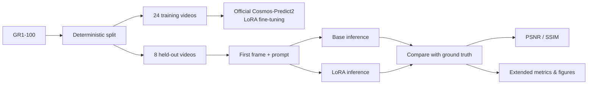
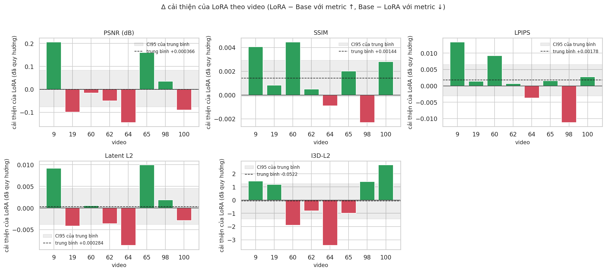

<div align="center">

# Cosmos-Predict2 × LoRA

### A small-scale video-generation experiment on robot manipulation data

Fine-tune NVIDIA's official **Cosmos-Predict2-2B-Video2World** model with LoRA,
then compare its generated futures with the untuned base model on held-out GR1-100 videos.

<p>
  <a href="https://github.com/nvidia-cosmos/cosmos-predict2"></a>
  
  <a href="https://huggingface.co/datasets/nvidia/GR1-100"></a>
  
</p>

[Training & inference](train_inference.ipynb) ·
[Extended evaluation](statistics.ipynb) ·
[Results summary](report/summary.md) ·
[Full analysis](report/report_extended.md)

</div>

> **Research glue, not a model reimplementation.** The notebooks run the official
> [Cosmos-Predict2](https://github.com/nvidia-cosmos/cosmos-predict2) code. This project
> provides a reduced-budget experiment configuration, data helpers, and evaluation code
> under [`src/`](src/).

## Contents

- [Experiment at a glance](#experiment-at-a-glance)
- [Workflow](#workflow)
- [Results](#results)
- [Extended analysis](#extended-analysis)
- [Run the notebooks](#run-the-notebooks)
- [Project layout](#project-layout)
- [Evaluation notes](#evaluation-notes)

## Experiment at a glance

| | Details |
|---|---|
| **Base model** | Cosmos-Predict2-2B-Video2World, official repository pinned to `661da477` |
| **Dataset** | [GR1-100](https://huggingface.co/datasets/nvidia/GR1-100) |
| **Split** | 24 training videos and 8 held-out videos |
| **Adaptation** | LoRA, rank 16, 300 training steps |
| **Primary metrics** | PSNR and SSIM against the held-out ground-truth video |
| **Runtime** | Google Colab GPU; Ampere-or-newer GPU with at least 32 GB VRAM recommended |

## Workflow



### The notebooks

| Notebook | Use it to… | Needs |
|---|---|---|
| [`train_inference.ipynb`](train_inference.ipynb) | Prepare the split, run base inference, fine-tune LoRA, evaluate both runs, and export `cosmos_outputs.zip`. | GPU runtime, Hugging Face access, and the official model dependencies |
| [`statistics.ipynb`](statistics.ipynb) | Analyze an existing `cosmos_outputs.zip` without repeating training or inference. Includes LPIPS, latent distance, FVD, I3D-L2, tables, figures, and comparison videos. | Saved outputs; a GPU or model downloads for some metrics |
| [`report/report_extended.md`](report/report_extended.md) | Read the generated detailed analysis with six metrics and per-video results. | None |

## Results

Current checked-in results on **8 held-out videos**. Values are mean ± standard deviation:

| Metric | Base | LoRA | Paired change (LoRA − Base) | LoRA better |
|---|---:|---:|---:|---:|
| PSNR ↑ (dB) | 12.077 ± 1.107 | 12.078 ± 1.145 | +0.0004 | 3 / 8 videos |
| SSIM ↑ | 0.4434 ± 0.0547 | 0.4448 ± 0.0561 | +0.0014 | 6 / 8 videos |
| LPIPS ↓ | 0.3882 ± 0.0487 | 0.3865 ± 0.0499 | −0.0018 | 6 / 8 videos |
| Latent L2 ↓ | 0.7424 ± 0.0677 | 0.7421 ± 0.0688 | −0.0003 | 4 / 8 videos |
| I3D-L2 ↓ | 39.641 ± 3.094 | 39.693 ± 3.754 | +0.0522 | 4 / 8 videos |

Paired bootstrap intervals for the primary pixel/structure metrics:

| Metric | Mean change | 95% bootstrap CI |
|---|---:|---:|
| PSNR | +0.0004 dB | [−0.0760, +0.0827] |
| SSIM | +0.0014 | [−0.0001, +0.0029] |

<p align="center">
  
  <br>
  <em>Positive values favor LoRA after orienting each metric so higher means better; gray bands show the 95% interval.</em>
</p>

**Takeaway:** none of the five paired metrics shows a statistically clear difference
between Base and LoRA. The small shifts in the averages should not be interpreted as a
reliable improvement.

## Extended analysis

The added evaluation also reports **FVD** (lower is better): Base **731.79**, LoRA
**743.22**. The paired difference is **+11.44** (LoRA − Base), with a video-bootstrap
95% interval of **[−54.84, +78.34]**; the interval includes zero. FVD uses only 8 videos
(160 overlapping clips per run) with 400-dimensional I3D features, so its covariance
estimate is rank-limited. Treat it as a relative comparison within this experiment,
not as a value comparable with published FVD benchmarks.

The detailed report includes per-video tables, paired tests, time-segment results,
metric correlations, effect-size plots, and visual comparisons:

- [Full extended report](report/report_extended.md) · [compact results summary](report/summary.md)
- [Forest plot of paired effects](report/forest_effect_sizes.png) ·
  [per-video improvement](report/improvement_per_video.png) ·
  [Base-vs-LoRA scatter](report/base_vs_lora_scatter.png)
- Example comparisons: [video 9](report/compare_9.mp4) · [video 64](report/compare_64.mp4)

The analysis covers **8 videos, one generated sample per video**, and only 300 LoRA
training steps over 24 training videos. It is exploratory: more held-out videos, more
random seeds, and task-specific measures of robot/object motion would be needed for
stronger conclusions.

## Run the notebooks

1. Open [`train_inference.ipynb`](train_inference.ipynb) in Colab and select an
   Ampere-or-newer GPU runtime with **at least 32 GB VRAM**. T4/L4-class GPUs do not meet
   the notebook's stated requirement for this model.
2. Provide the helper code using the notebook's `GLUE_REPO` setting or its zip-upload
   prompt. **Repository layout detail:** this checkout stores the helpers in `src/utils/`
   and the configuration in `src/overlay/`, while the notebook expects `eyecode/` and
   `overlay/` at the helper root. Package those directories under the expected names
   before uploading or cloning them into Colab.
3. Add `HF_TOKEN` to Colab Secrets and confirm your Hugging Face account can access
   `nvidia/Cosmos-Predict2-2B-Video2World` and `meta-llama/Llama-Guard-3-8B`.
4. Run the training/inference notebook from top to bottom, then download
   `cosmos_outputs.zip`.
5. Open [`statistics.ipynb`](statistics.ipynb), upload the zip, and run the cells for
   extended evaluation.

> The notebooks download large models and datasets and install the upstream environment.
> Check the upstream repository instructions and model/data terms before running.

To regenerate the compact report from saved score files, run from the repository root:

```bash
python -m src.utils.report --results src/results
```

The report reads/writes files under `src/results/`. The helper tests are in `src/tests/`;
they exercise synthetic data, not GPU training or inference.

## Project layout

```text
.
├── train_inference.ipynb     # Cosmos-Predict2 setup, training, inference, core metrics
├── statistics.ipynb          # Standalone extended evaluation
├── report/                   # Extended report, metric tables, plots, video comparisons
│   ├── summary.md
│   └── report_extended.md
└── src/
    ├── overlay/               # Small LoRA experiment configuration
    ├── utils/                 # Data splitting, video metrics, IDM evaluation, report
    ├── tests/                 # Synthetic-data tests
    ├── tools/                 # Notebook utility scripts
    └── results/               # Core evaluation scores and compact report outputs
```

## Evaluation notes

- PSNR and SSIM are computed against the recorded future video, with the conditioning
  frame excluded so the input frame does not inflate the scores.
- Similarity to one ground-truth future is not the same as robot task success.
- Eight evaluation videos are too few for strong conclusions; interpret the paired
  bootstrap intervals cautiously.
- Lower is better for LPIPS, Latent L2, I3D-L2, and FVD; higher is better for PSNR and
  SSIM. These metrics capture different notions of similarity and are not direct
  measures of task completion.
- The FVD estimate is especially uncertain with this small sample and high-dimensional
  features; use it only for a relative Base-vs-LoRA comparison under the same setup.
- The notebooks run official upstream code, but the local helper tests do not verify
  GPU training/inference, checkpoint compatibility, or the full Colab setup.
